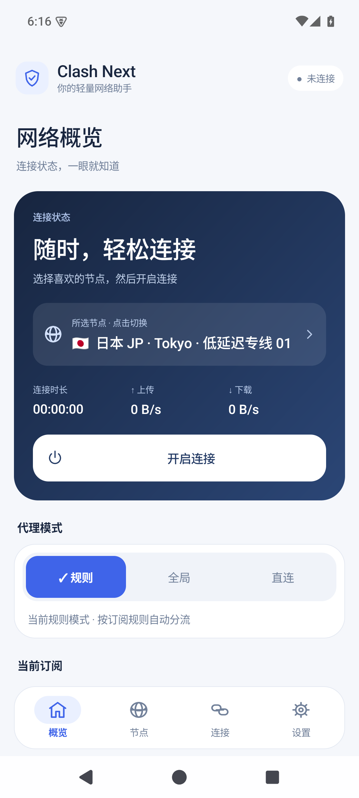
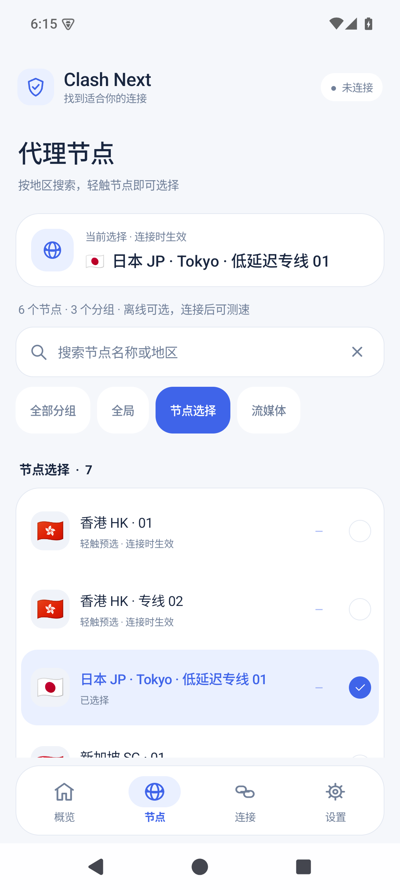
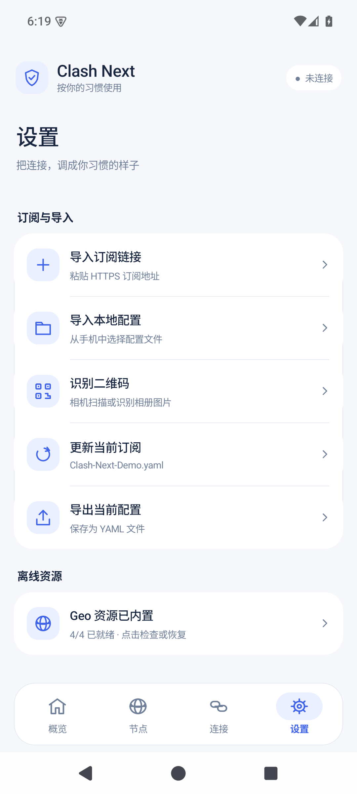

# Clash Next

一个面向日常使用的 Android 原生代理客户端，基于 [FlClash](https://github.com/chen08209/FlClash) 二次开发，复用 Mihomo 内核与 Android 服务层，以 Kotlin 原生界面重新整理连接、节点和诊断体验。

项目希望把几件事做好：连接状态看得懂，节点不连接也能选，桌面组件能够直接开关，遇到问题有日志可查。

[下载安装包](https://github.com/liven666/Clash-Next/releases/download/android-0.1.9-alpha10/Clash-Next-0.1.9-alpha10-android-arm64.apk) · [发布说明](https://github.com/liven666/Clash-Next/releases/tag/android-0.1.9-alpha10) · [使用指南](ANDROID_USER_SOP.md) · [构建指南](CLASH_NEXT_BUILD.md)

> 当前版本为 **0.1.9-alpha10**，仅发布 **Android arm64** 安装包，大小约 **33.92 MiB**，已内置全部 Geo 资源。仍处于 Alpha 测试阶段，使用开发签名；不是 FlClash 官方发行版。
>
> 本项目只提供客户端，不提供订阅、代理节点或 VPN 套餐。使用前需要自行准备有效的 Clash 配置或订阅。

## 为什么做这个项目

Clash Next 从个人使用需求出发，Android 优先，重点放在常用操作和系统集成上：

- **减少界面运行时依赖**：新版 APK 使用 Kotlin 原生界面，不内置 Flutter UI 运行时；保留现有内核的协议栈，不以删减协议来缩小安装包。
- **让状态更明确**：所选节点、代理模式、连接状态和连接时长都有持续反馈，关闭连接后仍保留节点选择。
- **让桌面开关更实用**：四种尺寸的小组件，按空间展示节点、国旗、时长和出口 IP 等信息。
- **让问题能够排查**：在应用内查看连接与近期请求，收集本地日志，并通过系统文件选择器导出。

## 功能一览

以下为当前版本已经实现的能力，不代表原 FlClash 的所有功能均已重构完成。

| 模块 | 当前能力 |
| --- | --- |
| 订阅与配置 | HTTPS 订阅导入、手动更新、本地 YAML 导入与导出、相机扫码、相册二维码识别 |
| 代理连接 | Android VPN 开启与关闭，规则 / 全局 / 直连模式，实时上传与下载速度、连接时长 |
| 节点管理 | 代理组筛选、节点搜索、未连接时浏览与预选、连接后切换节点及延迟测试、保存各组选择 |
| 桌面组件 | 1×2、1×4、2×2、2×4 尺寸，连接开关、节点与国旗、连接时长、出口 IP 及国家信息；宽布局额外展示实时速度 |
| 系统入口 | Android 快捷设置磁贴，原生 VPN 前台服务 |
| Geo 资源 | 内置 `GEOIP.dat`、`GEOSITE.dat`、`GEOIP.metadb`、`ASN.mmdb`，支持从 APK 本地恢复 |
| 连接与日志 | 活动连接、近期请求与详情，本地滚动日志、最近日志查看、清空与导出，常见凭据脱敏 |
| 界面 | 浅色 / 深色模式，统一的卡片与图标、点击反馈、系统栏安全距离、窄屏与大字体适配，设置页显示版本号 |

说明：

- 订阅直接包含的节点可以离线读取；远程提供器的节点需要至少成功加载一次，之后可离线查看名称缓存。
- 节点“测速”目前指延迟测试，需要内核运行；它不是下载带宽测试。
- 小组件会根据尺寸取舍信息。节点国旗根据名称推断，不等同于对服务器实际位置的验证；出口 IP 信息取决于查询是否成功。

## 界面预览

| 首页 | 节点 | 设置 |
| :---: | :---: | :---: |
|  |  |  |

截图来自 0.1.9-alpha10 的 Android 模拟器，使用虚构演示配置，不包含真实订阅或可用节点。

## 下载安装

前往 [Releases](https://github.com/liven666/Clash-Next/releases) 下载 APK。当前发布文件为：

`Clash-Next-0.1.9-alpha10-android-arm64.apk`

- **架构**：`arm64-v8a`，不提供当前版本的 32 位 ARM 或 x86 安装包。
- **最低系统声明**：Android 6.0（API 23）；实际已验证范围见下方“当前状态与限制”。
- **包名**：`com.follow.clash.next`，与原 FlClash 及早期 Personal 版区分。
- **版本确认**：打开“设置”，滚动到底部查看。
- **文件校验**：发布页附带 `.sha256` 校验文件。

同签名版本可直接覆盖升级。不要先卸载旧版：卸载会删除本地配置、节点选择和日志。如果提示签名不一致，请先导出配置，不要盲目卸载。

## 快速开始

1. 安装 APK，打开 **Clash Next**。
2. 进入 **设置 → 订阅与导入 → 导入订阅链接**，粘贴 HTTPS 订阅地址；也可导入 YAML 文件或识别二维码。
3. 打开 **节点**，搜索、筛选并预选想使用的节点。
4. 返回首页，选择代理模式。日常使用通常选择“规则”，按订阅中的规则分流。
5. 点击 **开启连接**，首次使用时允许 Android 建立 VPN。
6. 连接后可进行延迟测试、切换节点；需要停止时点击 **断开连接**。

Geo 资源已经打包。首次启动会从 APK 解压到本地，缺失时也可在“设置 → 离线资源”恢复，不需要另行联网下载。订阅获取、远程提供器更新及正常代理流量仍然需要网络。

完整操作步骤见 [Android 使用 SOP](ANDROID_USER_SOP.md)。

### 使用桌面小组件

先在应用内导入配置并完成首次 VPN 授权，再从系统桌面的小组件列表添加 Clash Next，按需要调整尺寸。

组件左侧集中放置连接开关，右侧展示状态信息；点击信息区域可进入应用。不同桌面可能对组件尺寸和后台行为有额外限制，vivo 相关验证状态见下文。

### 遇到连接问题

先复现问题，再打开 **设置 → 诊断日志 → 导出诊断日志**。反馈时附上应用版本、设备型号、Android 版本和操作步骤。

日志会对常见凭据脱敏，但分享前仍应人工检查。不要把订阅链接、完整配置、Token 或密码直接贴到公开 Issue。

## 隐私与联网边界

- 新版客户端不集成广告、Firebase Analytics、Crashlytics 或 Google ML Kit。
- 二维码由本地 ZXing 方案识别；配置和诊断日志保存在设备本地，不自动上传。
- 诊断日志采用滚动保存，容量上限约 2 MB，可手动清空和导出。
- 订阅下载、代理 / 规则提供器更新以及配置指定的网络行为会正常联网。
- 为展示出口 IP 和国家信息，连接运行后会访问第三方 IP 查询服务（当前使用 `api.ip.sb` 与 `ipwho.is`）。查询服务能看到请求出口 IP；这不是完全离线的功能。

“没有统计上传”不代表客户端没有网络请求，也不代表代理服务商无法看到经其转发的流量。

## 当前状态与限制

这是供个人使用和测试的 Alpha 版本，不应视为已经完成全设备、全订阅覆盖验证的稳定产品。

- **已记录的验证**：33 项原生单元测试通过；Release Lint 无错误，仍有 53 项警告。Android 15 ARM64 模拟器已检查导入、节点搜索 / 预选、模式反馈、直连模式启停、计时重置、深浅色和窄屏大字体布局。
- **真机验证仍需补充**：包含 vivo 桌面尺寸回调的兼容处理，但本版尚未完成 vivo X300 Pro 真机复测。模拟器结果不能替代实际订阅、后台保活和各厂商桌面的测试。
- **签名仍为开发签名**：自行编译的证书通常与发布包不同，不保证能够覆盖安装。
- **平台范围**：此次仅发布 Android 原生版。仓库保留的 Windows / macOS / Linux 代码属于旧 Flutter 客户端；不代表已经提供 Clash Next 对应新版。iOS 尚未实现。

### 后续方向

以下能力尚未完成或暂缓，不能作为当前版功能使用：

- 订阅流量与到期时间展示。
- 应用分流白名单 / 黑名单编辑器。
- 完整的本地备份、恢复与旧版数据迁移。
- 日志搜索、更多连接管理能力和累计流量展示。
- WebDAV、JavaScript 覆盖脚本和图形化规则 / 高级 DNS 编辑器。
- Windows、macOS 等后续平台的新版客户端。

实现进度与各版本改动见 [V2_STATUS.md](V2_STATUS.md)。[早期需求文档](V2_REQUIREMENTS.md)保留了历史方案，其中 Geo 按需下载和原有体积目标已被后续决策替代。

## 开发与构建

新版入口是 `android/v2app`，不是 `android/app`。

```text
android/v2app/       新版 Kotlin 界面、状态、订阅、组件与诊断
android/service/    复用的 Android VPN / 服务层
android/common/     Android 公共代码
android/core/       JNI / C++ 桥接与原生内核接入
core/               Go 桥接及固定版本的 Clash.Meta 子模块
assets/data/        打包使用的四份 Geo 资源
android/app/、lib/   保留的旧 Flutter 客户端
```

```bash
git clone --recurse-submodules https://github.com/liven666/Clash-Next.git
cd Clash-Next
```

构建仍需要 Flutter / Dart 工具链，因为共享 Gradle 工程和内核构建脚本依赖它；这不代表新版 APK 内包含 Flutter UI。工具版本、内核生成、原生测试、打包和签名注意事项见 [CLASH_NEXT_BUILD.md](CLASH_NEXT_BUILD.md)。

上游旧版的多平台发布流程已单独归档，不作为 Clash Next 的自动发布流程使用。

## 致谢与许可证

感谢 [FlClash](https://github.com/chen08209/FlClash) 提供客户端、服务层与构建基础，感谢 [Clash.Meta / Mihomo](https://github.com/chen08209/Clash.Meta) 及 ZXing 等开源项目。

- FlClash 基线提交：`7c831855efedceb1a72bd0b4c18da026593d0853`。
- Clash.Meta 子模块提交：`80362fc1895dcf60b79b562896653046e0687413`。
- 本仓库保留原始历史与版权声明，采用 [GNU GPLv3](LICENSE) 许可证。
- 原项目说明已独立保留：[English](UPSTREAM_README.md) / [简体中文](UPSTREAM_README_zh_CN.md)。

Clash Next 是独立维护的二次开发版本，与 FlClash 官方发行和支持渠道相区分。
